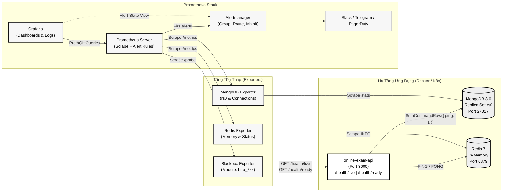

# Giám Sát Sức Khỏe Hệ Thống & Cảnh Báo — Online Exam API

Tài liệu này mô tả chi tiết các health check endpoints của dịch vụ **Online Exam API** (`NestJS 12` + `@nestjs/terminus`), hướng dẫn cấu hình **Probes** cho **Docker Compose / Kubernetes**, và thiết lập hệ thống thu thập chỉ số, cảnh báo, trực quan hóa với **Prometheus**, **Alertmanager** và **Grafana**.

> [!IMPORTANT]
> **Hiện trạng codebase (`online-exam-api`):**
> * Ứng dụng **đã triển khai** đầy đủ các endpoint sức khỏe qua `@nestjs/terminus` (`/health`, `/health/live`, `/health/ready`, `/api/v1/health`, `/api/v1/health/live`, `/api/v1/health/ready`) cùng cấu hình `healthcheck` trong `docker-compose.yml`.
> * Ứng dụng **chưa tích hợp** endpoint `/metrics` gốc (`prom-client` / `@willsoto/nestjs-prometheus`) và chưa có manifest Kubernetes/Prometheus/Grafana sẵn trong repository.
> * Do đó, kiến trúc giám sát Prometheus hiện tại sử dụng **Blackbox Exporter** (probe HTTP tới `/health/live` và `/health/ready`) kết hợp với **MongoDB Exporter** (theo dõi Replica Set `rs0`) và **Redis Exporter** (theo dõi Redis). Mục [3.3](#33-mở-rộng-tương-lai--ứng-dụng-metrics-endpoint-metrics) cung cấp lộ trình bổ sung `/metrics` khi cần thu thập HTTP/business metrics sâu hơn.



---

## 1. Tổng Quan Health Check Endpoints

Toàn bộ health check được cài đặt trong `src/health/health.controller.ts` (thuộc `HealthModule`, import `TerminusModule`, `PrismaModule`, `RedisModule`):

* **Cổng mặc định:** `3000` (cấu hình qua biến môi trường `PORT`).
* **Miễn trừ tiền tố toàn cục (`Global Prefix Exclusion`):** Trong `src/main.ts`, `app.setGlobalPrefix('api/v1', { exclude: ['health', 'health/(.*)', 'api/v1/health', 'api/v1/health/(.*)'] })` giúp cả route gốc (`/health*`) lẫn route có tiền tố (`/api/v1/health*`) đều hoạt động nhất quán mà không bị lặp tiền tố.
* **Miễn trừ xác thực & Rate Limit:** `HealthController` được gắn `@SkipThrottle()` và **không** gắn `JwtAuthGuard` hay `RolesGuard`, đảm bảo kubelet, Docker daemon và Prometheus Blackbox Exporter có thể probe liên tục mà không bị chặn `401`/`429`.
* **Tài liệu Swagger:** Nhóm `@ApiTags('Health')` hiển thị tại `/docs`.

### 1.1. Danh Sách Các Routes

| HTTP Method & Routes | Controller Handler | Thành phần kiểm tra | Mã HTTP trả về | Mục đích sử dụng |
| :--- | :--- | :--- | :--- | :--- |
| `GET /health`<br/>`GET /api/v1/health` | `check()` | `database` (MongoDB) + `redis` (chạy song song) | `200 OK` (cả 2 khỏe)<br/>`503 Service Unavailable` (1 trong 2 lỗi) | Kiểm tra sức khỏe tổng thể (Readiness / Smoke check) |
| `GET /health/live`<br/>`GET /api/v1/health/live` | `live()` | Không kiểm tra DB/Redis (`health.check([])`) | `200 OK` (khi tiến trình NestJS còn phản hồi) | **Liveness Probe** (Kubernetes / Load Balancer) |
| `GET /health/ready`<br/>`GET /api/v1/health/ready` | `ready()` | `database` (MongoDB) + `redis` (chạy song song) | `200 OK` (cả 2 khỏe)<br/>`503 Service Unavailable` (1 trong 2 lỗi) | **Readiness Probe** & **Docker Compose Healthcheck** |

### 1.2. Cơ Chế Kiểm Tra & Ngưỡng Timeout Nội Bộ

`HealthCheckService` của `@nestjs/terminus` thực thi danh sách các indicator song song qua `Promise.allSettled(...)`:

| Indicator Key | Nguồn triển khai | Lệnh kiểm tra thực tế | Ngưỡng Timeout | Điều kiện lỗi (`status: "down"`) |
| :--- | :--- | :--- | :--- | :--- |
| `database` | `PrismaHealthIndicator.pingCheck('database', this.prisma)` | `prisma.$runCommandRaw({ ping: 1 })` | `1000ms` (mặc định của Terminus) | Mất kết nối MongoDB, Replica Set `rs0` không có Primary (`ReplicaSetNoPrimary`), hoặc quá `1000ms` (`timeout of 1000ms exceeded`). |
| `redis` | `checkRedis()` qua `HealthIndicatorService.check('redis')` & `RedisService.ping()` | `client.ping()` (yêu cầu trả về đúng `'PONG'`) | `connectTimeout: 1000ms`<br/>`pingTimeout: 1500ms`<br/>Terminus `.withTimeout(2000)` | Socket lỗi (`ECONNREFUSED`, `Connection is closed`), phản hồi khác `'PONG'` (`Unexpected Redis ping response: ...`), quá `1500ms`/`2000ms`, hoặc chưa cấu hình Redis (`Redis is not configured`). |

> [!WARNING]
> **Lưu ý quan trọng khi chưa cấu hình biến môi trường Redis (`Redis is not configured`):**
> Theo `src/redis/redis.service.ts` và `.env.example`, nếu cả `REDIS_URL` và `REDIS_HOST` đều bỏ trống, ứng dụng vẫn khởi động bình thường (`client = null`), `/health/live` trả về `200 OK`, nhưng `/health` và `/health/ready` sẽ trả về `503 Service Unavailable` với thông điệp `"Redis is not configured"`. Trong môi trường Docker/Production, luôn cấu hình `REDIS_URL` hoặc `REDIS_HOST` để Readiness Probe đạt trạng thái `200 OK`.

### 1.3. Mẫu JSON Phản Hồi Thực Tế

#### Trường hợp 1: `/health/live` hoặc `/api/v1/health/live` (`200 OK`)

```json
{
  "status": "ok",
  "info": {},
  "error": {},
  "details": {}
}
```

#### Trường hợp 2: `/health` hoặc `/health/ready` khi MongoDB & Redis cùng phản hồi (`200 OK`)

```json
{
  "status": "ok",
  "info": {
    "database": {
      "status": "up",
      "responseTime": 2
    },
    "redis": {
      "status": "up",
      "responseTime": 1
    }
  },
  "error": {},
  "details": {
    "database": {
      "status": "up",
      "responseTime": 2
    },
    "redis": {
      "status": "up",
      "responseTime": 1
    }
  }
}
```

#### Trường hợp 3: `/health/ready` khi Redis mất kết nối hoặc chưa cấu hình (`503 Service Unavailable`)

```json
{
  "status": "error",
  "info": {
    "database": {
      "status": "up",
      "responseTime": 2
    }
  },
  "error": {
    "redis": {
      "status": "down",
      "message": "Redis connection closed (ECONNREFUSED)",
      "responseTime": 1
    }
  },
  "details": {
    "database": {
      "status": "up",
      "responseTime": 2
    },
    "redis": {
      "status": "down",
      "message": "Redis connection closed (ECONNREFUSED)",
      "responseTime": 1
    }
  }
}
```

*(Khi chưa cấu hình `REDIS_URL` / `REDIS_HOST`, `error.redis.message` sẽ là `"Redis is not configured"`.)*

#### Trường hợp 4: `/health/ready` khi MongoDB Replica Set mất kết nối / mất Primary (`503 Service Unavailable`)

```json
{
  "status": "error",
  "info": {
    "redis": {
      "status": "up",
      "responseTime": 1
    }
  },
  "error": {
    "database": {
      "status": "down",
      "message": "ReplicaSetNoPrimary: No primary replica set member available",
      "responseTime": 1001
    }
  },
  "details": {
    "redis": {
      "status": "up",
      "responseTime": 1
    },
    "database": {
      "status": "down",
      "message": "ReplicaSetNoPrimary: No primary replica set member available",
      "responseTime": 1001
    }
  }
}
```

---

## 2. Cấu Hình Probes cho Docker Compose & Kubernetes

### 2.1. Hiện Trạng trên Docker Compose (`docker-compose.yml`)

File `docker-compose.yml` hiện tại đã thiết lập chuỗi kiểm tra phụ thuộc (`depends_on: condition: service_healthy`) và `healthcheck` cho cả 3 dịch vụ:

* **`api`:** Kiểm tra `wget -qO- http://localhost:3000/api/v1/health/ready` với `interval: 15s`, `timeout: 5s`, `retries: 3`, `start_period: 20s`.
* **`mongo` (`mongo:8.0`, `--replSet rs0`):** Chạy `mongosh` kiểm tra `rs.status().ok` và tự động `rs.initiate(...)` nếu chưa khởi tạo (`interval: 5s`, `timeout: 10s`, `retries: 12`).
* **`redis` (`redis:7-alpine`):** Chạy `redis-cli ping` (`interval: 5s`, `timeout: 3s`, `retries: 10`).

### 2.2. Cấu Hình Tham Khảo cho Kubernetes (`Deployment`)

Khi triển khai lên Kubernetes, cần tách biệt rõ **`livenessProbe`** (`/health/live`) và **`readinessProbe`** (`/health/ready`):

```yaml
apiVersion: apps/v1
kind: Deployment
metadata:
  name: online-exam-api
spec:
  replicas: 2
  template:
    spec:
      containers:
        - name: api
          image: online-exam-api:latest
          ports:
            - containerPort: 3000
          startupProbe:
            httpGet:
              path: /health/live
              port: 3000
            initialDelaySeconds: 5
            periodSeconds: 5
            timeoutSeconds: 2
            failureThreshold: 12 # Tối đa 60s để NestJS bootstrap & Prisma $connect()
          livenessProbe:
            httpGet:
              path: /health/live
              port: 3000
            periodSeconds: 15
            timeoutSeconds: 2
            failureThreshold: 3 # Chỉ restart Pod nếu event loop / HTTP server treo
          readinessProbe:
            httpGet:
              path: /health/ready
              port: 3000
            periodSeconds: 10
            timeoutSeconds: 3 # Lớn hơn Terminus Redis timeout (2000ms) & Mongo timeout (1000ms)
            failureThreshold: 3
            successThreshold: 1
```

> [!NOTE]
> **Nguyên tắc chọn Timeout & Endpoint cho Probes:**
> 1. **Tuyệt đối không trỏ `livenessProbe` vào `/health/ready`:** Nếu MongoDB Replica Set đang bầu chọn Primary mới (mất ~5–15s) hoặc Redis khởi động lại, `/health/ready` sẽ trả về `503`. Nếu `livenessProbe` gọi `/health/ready`, Kubernetes sẽ restart hàng loạt Pod API vô ích (`CrashLoopBackOff`) và làm quá tải kết nối khi DB phục hồi. Trỏ `livenessProbe` vào `/health/live` đảm bảo Pod chỉ bị rút khỏi Service (`readinessProbe` fail) mà không bị giết tiến trình.
> 2. **`readinessProbe.timeoutSeconds` (`3s`) > Terminus Timeout (`2000ms`):** Đảm bảo kubelet không cắt kết nối trước khi `HealthController` kịp tổng hợp và trả về JSON chi tiết `503` (giúp log/audit biết rõ do `database` hay `redis`).

---

## 3. Thu Thập Metrics & Quy Tắc Cảnh Báo với Prometheus

Vì `online-exam-api` chưa cài đặt `prom-client`, Prometheus thực hiện giám sát theo mô hình **Out-of-band HTTP Probing** kết hợp với các exporter cho tầng lưu trữ:

1. **Prometheus Blackbox Exporter:** Gọi định kỳ tới `/health/live` và `/health/ready` để thu thập `probe_success`, `probe_http_status_code`, và `probe_duration_seconds`.
2. **MongoDB Exporter (`percona/mongodb_exporter`):** Kết nối tới `mongodb://mongo:27017/?replicaSet=rs0` để theo dõi trạng thái thành viên Replica Set `rs0`, số lượng kết nối và latency thao tác.
3. **Redis Exporter (`oliver006/redis_exporter`):** Kết nối tới `redis:6379` để theo dõi trạng thái sống (`redis_up`), tỷ lệ sử dụng bộ nhớ, và lượng client kết nối.

### 3.1. Cấu Hình Scrape Mẫu (`blackbox.yml` & `prometheus.yml`)

```yaml
# blackbox.yml
modules:
  http_2xx_health:
    prober: http
    timeout: 4s
    http:
      method: GET
      valid_http_versions: ["HTTP/1.1", "HTTP/2.0"]
      valid_status_codes: [200]
      fail_if_body_not_matches_regexp:
        - '"status"\s*:\s*"ok"'
```

```yaml
# prometheus.yml (trích đoạn scrape_configs)
scrape_configs:
  - job_name: 'online-exam-api-liveness'
    metrics_path: /probe
    scrape_interval: 15s
    params:
      module: [http_2xx_health]
    static_configs:
      - targets:
          - http://api:3000/health/live
        labels:
          service: online-exam-api
          probe_type: liveness
    relabel_configs:
      - source_labels: [__address__]
        target_label: __param_target
      - source_labels: [__param_target]
        target_label: instance
      - target_label: __address__
        replacement: blackbox-exporter:9115

  - job_name: 'online-exam-api-readiness'
    metrics_path: /probe
    scrape_interval: 15s
    params:
      module: [http_2xx_health]
    static_configs:
      - targets:
          - http://api:3000/health/ready
        labels:
          service: online-exam-api
          probe_type: readiness
    relabel_configs:
      - source_labels: [__address__]
        target_label: __param_target
      - source_labels: [__param_target]
        target_label: instance
      - target_label: __address__
        replacement: blackbox-exporter:9115

  - job_name: 'mongodb-exporter'
    scrape_interval: 15s
    static_configs:
      - targets: ['mongodb-exporter:9216']
        labels:
          service: mongodb
          replica_set: rs0

  - job_name: 'redis-exporter'
    scrape_interval: 15s
    static_configs:
      - targets: ['redis-exporter:9121']
        labels:
          service: redis
```

### 3.2. Quy Tắc & Ngưỡng Cảnh Báo (`prometheus-alerts.yml`)

| Tên Alert | Thành phần | Điều kiện PromQL | `for` | Mức độ (`severity`) | Lý giải ngưỡng |
| :--- | :--- | :--- | :--- | :--- | :--- |
| `OnlineExamApiLivenessDown` | API Process | `probe_success{job="online-exam-api-liveness"} == 0` | `1m` | `critical` | Tiến trình API không phản hồi hoặc sập hoàn toàn qua 5 lần scrape liên tiếp (`0s, 15s, 30s, 45s, 60s` ở chu kỳ `15s`). |
| `OnlineExamApiReadinessFailed` | API Readiness | `probe_success{job="online-exam-api-readiness"} == 0` | `1m` | `critical` | API trả `503` hoặc không reachable, không thể phục vụ traffic thi cử (lỗi DB hoặc Redis). |
| `OnlineExamHealthProbeSlow` | Health Latency | `probe_duration_seconds{job="online-exam-api-readiness"} > 1.0` | `3m` | `warning` | Tổng thời gian ping vượt `1.0s` — sát ngưỡng timeout `1000ms` của MongoDB và `1500ms` của Redis, báo hiệu suy giảm hiệu năng sớm. |
| `MongoDbDown` | MongoDB Exporter | `mongodb_up == 0` | `1m` | `critical` | MongoDB Exporter mất kết nối tới node MongoDB. |
| `MongoReplicaSetNoPrimary` | MongoDB `rs0` | `absent(mongodb_rs_members_state{job="mongodb-exporter"} == 1) and on() up{job="mongodb-exporter"} == 1` | `1m` | `critical` | Prisma bắt buộc có Primary trong Replica Set `rs0` cho ACID transactions (nộp bài, chấm điểm, thu hồi token); chỉ cảnh báo khi `mongodb-exporter` đang `up`. |
| `RedisDown` | Redis Exporter | `redis_up == 0` | `1m` | `critical` | Redis không phản hồi `PING`, làm `/health/ready` trả `503` và ảnh hưởng cache/leaderboard. |
| `RedisHighMemoryUsage` | Redis Memory | `(redis_memory_used_bytes / redis_memory_max_bytes) > 0.8 and redis_memory_max_bytes > 0` | `5m` | `warning` | RAM Redis vượt 80% `maxmemory`, nguy cơ eviction dữ liệu cache hoặc OOM. |

```yaml
# prometheus-alerts.yml
groups:
  - name: online-exam-health.rules
    rules:
      - alert: OnlineExamApiLivenessDown
        expr: probe_success{job="online-exam-api-liveness"} == 0
        for: 1m
        labels:
          severity: critical
          service: online-exam-api
        annotations:
          summary: "Online Exam API Liveness Down ({{ $labels.instance }})"
          description: "Endpoint /health/live không trả về HTTP 200 trong hơn 1 phút."

      - alert: OnlineExamApiReadinessFailed
        expr: probe_success{job="online-exam-api-readiness"} == 0
        for: 1m
        labels:
          severity: critical
          service: online-exam-api
        annotations:
          summary: "Online Exam API Readiness Failed ({{ $labels.instance }})"
          description: "Endpoint /health/ready trả về lỗi (probe_success={{ $value }}, kỳ vọng HTTP 200). Kiểm tra kết nối MongoDB rs0 và Redis."

      - alert: OnlineExamHealthProbeSlow
        expr: probe_duration_seconds{job="online-exam-api-readiness"} > 1.0
        for: 3m
        labels:
          severity: warning
          service: online-exam-api
        annotations:
          summary: "Health probe latency cao ({{ $labels.instance }})"
          description: "Thời gian phản hồi /health/ready đạt {{ $value | humanizeDuration }} (> 1.0s), tiệm cận ngưỡng timeout 1000ms/1500ms."

      - alert: MongoDbDown
        expr: mongodb_up == 0
        for: 1m
        labels:
          severity: critical
          service: mongodb
        annotations:
          summary: "MongoDB không phản hồi ({{ $labels.instance }})"
          description: "MongoDB Exporter không thể kết nối tới instance trong hơn 1 phút."

      - alert: MongoReplicaSetNoPrimary
        expr: absent(mongodb_rs_members_state{job="mongodb-exporter"} == 1) and on() up{job="mongodb-exporter"} == 1
        for: 1m
        labels:
          severity: critical
          service: mongodb
        annotations:
          summary: "MongoDB Replica Set rs0 mất Primary"
          description: "Không có node nào ở trạng thái PRIMARY (state=1) trong Replica Set rs0; mọi giao dịch Prisma sẽ thất bại."

      - alert: RedisDown
        expr: redis_up == 0
        for: 1m
        labels:
          severity: critical
          service: redis
        annotations:
          summary: "Redis không phản hồi ({{ $labels.instance }})"
          description: "Redis Exporter báo redis_up == 0 trong hơn 1 phút."

      - alert: RedisHighMemoryUsage
        expr: (redis_memory_used_bytes / redis_memory_max_bytes) > 0.8 and redis_memory_max_bytes > 0
        for: 5m
        labels:
          severity: warning
          service: redis
        annotations:
          summary: "Bộ nhớ Redis vượt 80% ({{ $labels.instance }})"
          description: "Mức sử dụng RAM Redis hiện tại là {{ $value | humanizePercentage }} của maxmemory."
```

### 3.3. Mở Rộng Tương Lai — Ứng Dụng Metrics (`/metrics`)

Khi đội ngũ phát triển bổ sung `prom-client` hoặc `@willsoto/nestjs-prometheus` cho `online-exam-api`, cần lưu ý các điểm tích hợp sau:

1. **Loại trừ prefix & Throttler:** Thêm `'metrics'` vào danh sách `exclude` trong `app.setGlobalPrefix('api/v1', ...)` tại `src/main.ts` và gắn `@SkipThrottle()` tương tự `HealthController`.
2. **Nhóm metrics nên thu thập bổ sung:**
   * **HTTP Golden Signals:** Tỷ lệ lỗi `5xx`, độ trễ `p95`/`p99` trên các API trọng yếu (`POST /api/v1/exams/:examId/attempts`, `PUT /api/v1/attempts/:attemptId/answers/:questionId`).
   * **Rate Limiting (`429 Too Many Requests`):** Theo dõi tần suất chạm ngưỡng ở `POST /api/v1/auth/login` (`5 req/phút`) và `PUT /api/v1/attempts/:attemptId/answers/:questionId` (`5 req/giây/user`) để phát hiện tấn công brute-force hoặc lỗi retry từ client.
   * **Cron Scheduler (`AttemptSchedulerService`):** Thời gian thực thi và số lỗi của job `@Cron('*/10 * * * * *')` tự động thu bài hết hạn (`BATCH_SIZE = 50`).

---

## 4. Định Tuyến & Ức Chế Cảnh Báo với Alertmanager

Alertmanager chịu trách nhiệm gom nhóm (`group_by`), khử trùng lặp, định tuyến theo mức độ (`severity`), và **ức chế (`inhibit_rules`)** để tránh bão cảnh báo (alert storm) khi một sự cố gốc kéo theo nhiều cảnh báo phụ thuộc.

### 4.1. Cấu Hình Tham Khảo (`alertmanager.yml`)

```yaml
global:
  resolve_timeout: 5m

route:
  receiver: 'slack-ops-alerts'
  group_by: ['alertname', 'service', 'severity']
  group_wait: 30s
  group_interval: 5m
  repeat_interval: 4h
  routes:
    - matchers:
        - severity="critical"
      receiver: 'ops-critical-pager'
      group_wait: 15s
      repeat_interval: 30m
      continue: false
    - matchers:
        - severity="warning"
      receiver: 'slack-ops-alerts'
      repeat_interval: 4h

inhibit_rules:
  # 1. Nếu tiến trình API sập hoàn toàn (/health/live down), ức chế Readiness & Slow Probe
  - source_matchers:
      - alertname="OnlineExamApiLivenessDown"
    target_matchers:
      - alertname=~"OnlineExamApiReadinessFailed|OnlineExamHealthProbeSlow"
    equal: ['service']

  # 2. Nếu Readiness đã báo lỗi (thường do timeout > 1.0s trả 503), ức chế cảnh báo chậm (Slow Probe)
  - source_matchers:
      - alertname="OnlineExamApiReadinessFailed"
    target_matchers:
      - alertname="OnlineExamHealthProbeSlow"
    equal: ['service']

  # 3. Nếu MongoDB hoặc Redis đã xác nhận down, ức chế cảnh báo chậm (Slow Probe)
  # Lưu ý: nếu dùng chung 1 Alertmanager cho nhiều môi trường (staging/prod), bổ sung `equal: ['env']` (hoặc `['cluster']`)
  - source_matchers:
      - alertname=~"MongoDbDown|MongoReplicaSetNoPrimary|RedisDown"
    target_matchers:
      - alertname="OnlineExamHealthProbeSlow"

receivers:
  - name: 'ops-critical-pager'
    slack_configs:
      - api_url_file: '/etc/alertmanager/secrets/slack_webhook_critical'
        channel: '#ops-critical'
        send_resolved: true
        title: '[{{ .Status | toUpper }}] {{ .CommonLabels.alertname }}'
        text: '{{ range .Alerts }}• {{ .Annotations.summary }} — {{ .Annotations.description }}{{ "\n" }}{{ end }}'

  - name: 'slack-ops-alerts'
    slack_configs:
      - api_url_file: '/etc/alertmanager/secrets/slack_webhook_alerts'
        channel: '#ops-alerts'
        send_resolved: true
```

> [!NOTE]
> **Bảo mật Webhook URL trong Alertmanager:** Alertmanager gốc **không** tự động mở rộng biến môi trường shell (`${...}`) trong `alertmanager.yml` nếu không qua bước render template/`envsubst`. Do đó, khuyến nghị dùng `api_url_file` trỏ tới file secret mount sẵn từ Docker Secret hoặc Kubernetes Secret.

### 4.2. Giải Thích Tham Số Định Tuyến

| Tham số | Giá trị khuyến nghị | Ý nghĩa vận hành |
| :--- | :--- | :--- |
| `group_by` | `['alertname', 'service', 'severity']` | Gom các alert cùng loại trên nhiều replica/instance thành 1 thông báo duy nhất. |
| `group_wait` | `15s` (`critical`) / `30s` (`warning`) | Đợi gom thêm các alert phát sinh cùng lúc trước khi gửi thông báo đầu tiên. |
| `group_interval` | `5m` | Khoảng thời gian tối thiểu trước khi gửi cập nhật nếu có alert mới gia nhập nhóm. |
| `repeat_interval` | `30m` (`critical`) / `4h` (`warning`) | Nhắc lại nếu sự cố nghiêm trọng chưa được khắc phục mà không gây spam kênh cảnh báo. |
| `inhibit_rules` | Liveness → Readiness/Slow; Readiness → Slow; DB/Redis Down → Slow | Triệt tiêu cảnh báo triệu chứng phụ khi nguyên nhân gốc (API chết, Readiness fail, hoặc DB/Redis sập) đã được báo cáo. |

---

## 5. Hướng Dẫn Dashboard & Alerting trên Grafana

### 5.1. Bố Cục Dashboard Khuyến Nghị (`Online Exam API — Health & Dependencies`)

| Hàng (Row) | Panel đề xuất | Nguồn dữ liệu / Truy vấn mẫu | Mục tiêu quan sát |
| :--- | :--- | :--- | :--- |
| **Row 1: API Health & Golden Signals** | • **Liveness Uptime (%)**<br/>• **Readiness Status (UP/DOWN)**<br/>• **Health Probe Latency (p95)**<br/>• **Blackbox HTTP Status Code** | `avg_over_time(probe_success{job="online-exam-api-liveness"}[24h]) * 100`<br/>`probe_success{job="online-exam-api-readiness"}`<br/>`quantile_over_time(0.95, probe_duration_seconds{job="online-exam-api-readiness"}[5m])`<br/>`probe_http_status_code{job=~"online-exam-api-.*"}` | Phát hiện tức thời API chết (`/health/live`), mất sẵn sàng (`503` trên `/health/ready`), hoặc độ trễ tiệm cận timeout. |
| **Row 2: Dependencies (`MongoDB rs0` & `Redis`)** | • **MongoDB `rs0` Member State**<br/>• **MongoDB Connections & Opcounters**<br/>• **Redis Status (`redis_up`) & Clients**<br/>• **Redis Memory Utilization (%)** | `mongodb_rs_members_state`<br/>`mongodb_ss_connections{conn_type="current"}`<br/>`redis_up`, `redis_connected_clients`<br/>`redis_memory_used_bytes / redis_memory_max_bytes` | Xác nhận ngay Replica Set `rs0` còn Primary hay không, kết nối có bị bão hòa không, và Redis còn đủ bộ nhớ không. |
| **Row 3: Container Logs (Loki / Docker Logs)** | • **Terminus Health Failures**<br/>• **Redis Client Errors**<br/>• **Cron Auto-Finalize Errors** | Bộ lọc chuỗi log:<br/>`"Health Check has failed!"`<br/>`"Redis client error"` hoặc `"Redis is not configured"`<br/>`"Failed to auto-finalize expired attempt"` | Đọc trực tiếp nguyên nhân gốc JSON (`error.database.message`, `error.redis.message`) do `@nestjs/terminus` và `RedisService` ghi ra `stdout`/`stderr`. |

### 5.2. Lưu Ý Giữa Grafana Unified Alerting và Prometheus + Alertmanager

> [!IMPORTANT]
> **Tránh cảnh báo trùng lặp (Duplicate Alerting):**
> * Giữ **Prometheus + Alertmanager làm nguồn chân lý duy nhất (Single Source of Truth)** cho các rule đánh giá metric và định tuyến thông báo (như cấu hình ở Mục 3 và Mục 4).
> * Trong Grafana, chỉ thêm Alertmanager làm Alertmanager Data Source để **hiển thị trạng thái alert và tạo Silence trên UI**, **không** định nghĩa lại cùng các rule `probe_success` trong Grafana Unified Alerting.
> * Chỉ nên dùng Grafana Alerting cho các nguồn dữ liệu mà Prometheus không trực tiếp đánh giá được (ví dụ: đếm dòng log lỗi `"Health Check has failed!"` từ **Loki**).

---

## 6. Kiểm Chứng & Runbook Xử Lý Nhanh

### 6.1. Lệnh Kiểm Chứng Nhanh

```bash
# 1. Kiểm tra Liveness (luôn kỳ vọng HTTP 200 {"status":"ok",...})
curl -i http://localhost:3000/health/live

# 2. Kiểm tra Readiness qua cả 2 đường dẫn (200 khi khỏe, 503 khi DB/Redis lỗi)
curl -i http://localhost:3000/health/ready
curl -i http://localhost:3000/api/v1/health/ready

# 3. Kiểm tra trạng thái healthcheck của các container trong Docker Compose
docker compose ps

# 4. Chạy bộ test tự động xác minh HealthController & E2E
npm test -- src/health/health.controller.spec.ts
npm run test:e2e -- test/health-and-throttler.e2e-spec.ts
```

### 6.2. Runbook Xử Lý Sự Cố Thường Gặp

| Triệu chứng quan sát | Nguyên nhân phổ biến | Hành động xử lý ngay của DevOps |
| :--- | :--- | :--- |
| `/health/live` trả `200`, nhưng `/health/ready` trả `503` với `error.redis.message = "Redis is not configured"` | Cả `REDIS_URL` và `REDIS_HOST` đều chưa được thiết lập trong `.env` / Pod env. | Kiểm tra biến môi trường container (`REDIS_URL=redis://redis:6379` hoặc `REDIS_HOST`), cập nhật cấu hình và restart container API. |
| `/health/ready` trả `503` với `error.redis.message` chứa `ECONNREFUSED` hoặc `Redis ping timed out after 1500ms` | Redis container/service ngừng hoạt động, sai cổng/mật khẩu, hoặc nghẽn mạng. | Kiểm tra `docker compose ps` / trạng thái Pod Redis, test `redis-cli ping`, kiểm tra `REDIS_PASSWORD` và kết nối mạng nội bộ. |
| `/health/ready` trả `503` với `error.database.status = "down"` (`Mongo connection refused`, `ReplicaSetNoPrimary`, hoặc `timeout of 1000ms exceeded`) | MongoDB ngừng hoạt động, chưa chạy `rs.initiate(...)` cho Replica Set `rs0`, hoặc node Primary đang bầu chọn lại / quá tải CPU-IO. | Kiểm tra `mongosh --eval "rs.status()"`; nếu chưa khởi tạo Replica Set trên Docker Compose, kiểm tra healthcheck của service `mongo` và biến `DATABASE_URL` (`?replicaSet=rs0`). |
| Cả `/health/live` và `/health/ready` không kết nối được (Connection refused / Timeout) | Tiến trình Node.js (`dist/main.js`) bị crash khi khởi động (ví dụ thiếu `JWT_SECRET` khiến `AuthSecurityModule` ném lỗi qua `configService.getOrThrow`, hoặc thiếu `S3_*` không đạt schema trong `env.validation.ts`) hoặc nghẽn port `3000`. | Xem log khởi động container (`docker compose logs api`), kiểm tra `ConfigModule` / bootstrap errors và giới hạn tài nguyên CPU/RAM của container. |
