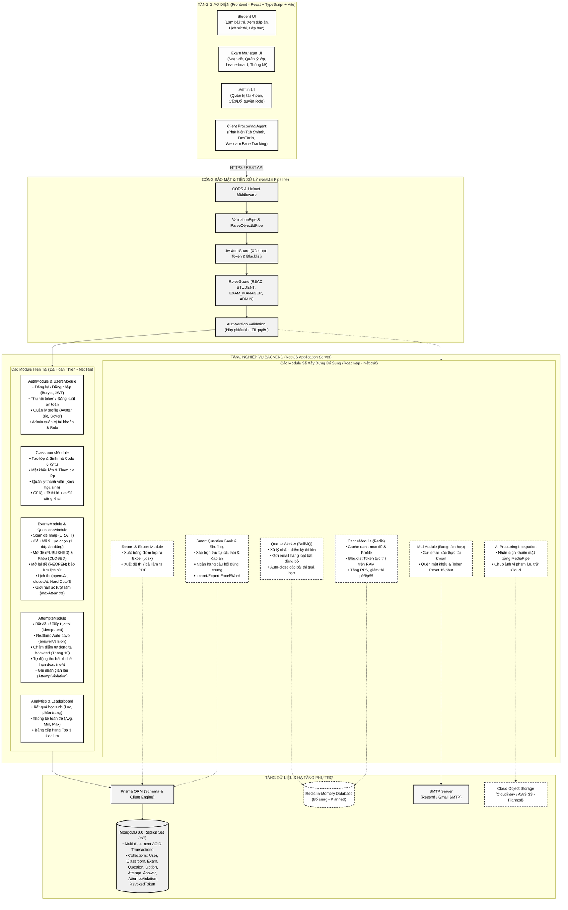
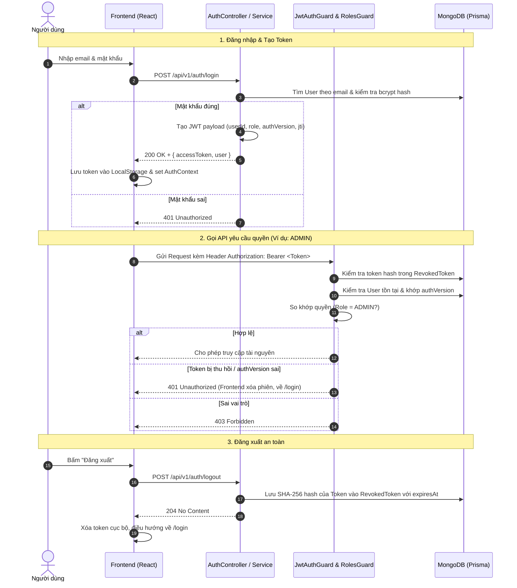
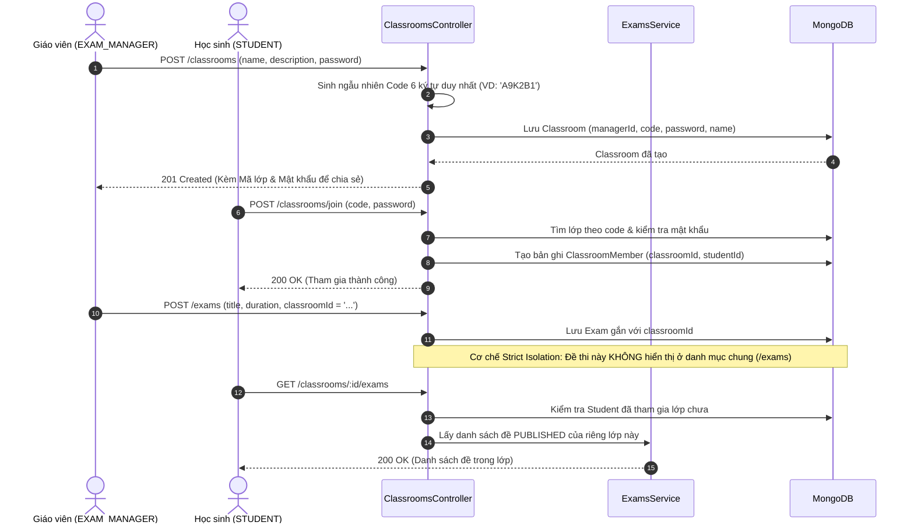
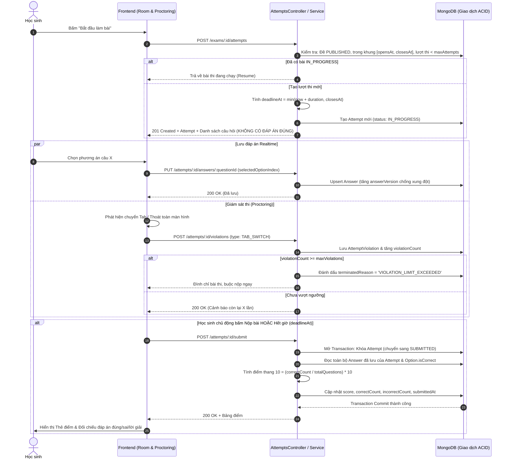
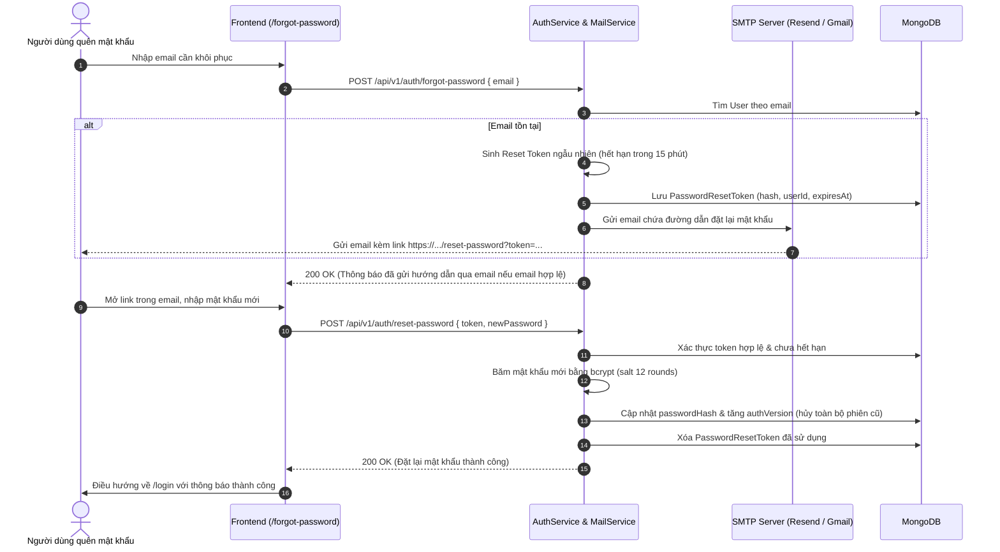
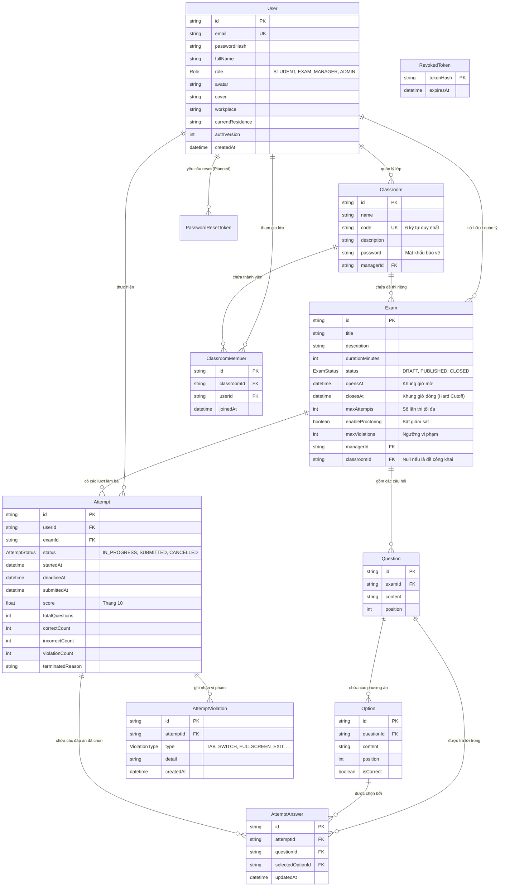

# Kiến Trúc Hệ Thống & Luồng Dự Án — Online Exam System

Tài liệu này tổng hợp toàn bộ kiến trúc hệ thống, luồng nghiệp vụ end-to-end của nền tảng thi trắc nghiệm trực tuyến (**Online Exam System**), bao gồm các phân hệ **đã hoàn thiện** (Core & Pha 1/Mở rộng) và các phân hệ **dự kiến xây dựng bổ sung** (Pha 2 & Tối ưu hóa).

---

## 1. Sơ Đồ Kiến Trúc Tổng Thể (System Architecture Diagram)

Hệ thống được thiết kế theo mô hình **Phân tầng (Layered Architecture)** kết hợp với **Domain-Driven Design (DDD)** hướng module trong NestJS, dữ liệu được quản lý giao dịch an toàn (ACID Transactions) trên MongoDB Replica Set.

---

## 2. Chi Tiết Các Luồng Nghiệp Vụ Cốt Lõi (Core Business Flows)

### 2.1. Luồng Xác Thực & Phân Quyền (Auth & RBAC Flow)

---

### 2.2. Luồng Quản Lý Lớp Học & Cô Lập Đề Thi (Classrooms & Isolation Flow)

---

### 2.3. Luồng Làm Bài Thi, Giám Sát Gian Lận & Chấm Điểm (Exam & Proctoring Flow)

---

## 3. Bản Đồ Các Thành Phần Hệ Thống (Hiện Tại vs Bổ Sung)

| Phân hệ / Khối chức năng | Thành phần hiện tại (Đã hoàn thiện) | Thành phần sẽ xây dựng bổ sung (Planned / Roadmap) |
| :--- | :--- | :--- |
| **1. Xác thực & Tài khoản** | • Đăng ký, đăng nhập JWT, bcrypt hash • Thu hồi token qua `RevokedToken` MongoDB • `authVersion` vô hiệu hóa phiên tức thì khi đổi quyền • Cập nhật thông tin cá nhân: avatar, cover, workplace | • **Khôi phục mật khẩu qua Email (Forgot/Reset password)** với token dùng 1 lần (Branch `feat/1-password`) • Đăng nhập mạng xã hội (Google / Microsoft OAuth2) • Xác thực 2 lớp (2FA - OTP) |
| **2. Quản trị hệ thống (Admin)** | • Quản lý người dùng: xem danh sách, lọc • Đổi vai trò tài khoản (`STUDENT`, `EXAM_MANAGER`, `ADMIN`) • Xóa tài khoản an toàn (chặn xóa nếu có dữ liệu ràng buộc) | • Nhật ký kiểm toán hệ thống (Audit Logs) • Dashboard giám sát tài nguyên máy chủ & throughput |
| **3. Không gian Lớp học (Classrooms)** | • Tạo lớp học với mã 6 ký tự & mật khẩu riêng • Tham gia lớp học bằng code + password • Quản lý thành viên lớp, loại học sinh khỏi lớp • Phân tách đề thi lớp học & đề thi công khai | • Diễn đàn trao đổi / Thông báo nội bộ lớp học • Quản lý tài liệu học tập đính kèm lớp (File/PDF) • Hệ thống Nhiệm vụ / Bài tập có deadline (Tasks/Assignments) |
| **4. Quản lý Đề thi & Câu hỏi** | • CRUD đề thi nháp (DRAFT), câu hỏi & lựa chọn • Xuất bản đề (PUBLISHED) & Đóng đề (CLOSED) • Mở lại đề (REOPEN) bảo lưu dữ liệu đợt cũ • Khung giờ tự động (`opensAt`, `closesAt`) & Hard Cutoff • Giới hạn số lượt làm bài (`maxAttempts`) | • **Xáo trộn thứ tự câu hỏi và lựa chọn (Shuffling)** ngẫu nhiên cho từng học sinh • Ngân hàng câu hỏi dùng chung phân loại theo chủ đề/mức độ khó • Nhập/xuất đề thi hàng loạt từ file Excel/Word • Hỗ trợ dạng câu hỏi chọn nhiều đáp án, điền từ, tự luận |
| **5. Phòng thi & Giám sát (Proctoring)** | • Làm bài trực tuyến, đếm ngược tự động khóa giờ • Tự động lưu đáp án theo thời gian thực (Auto-save) • Chấm điểm tự động tại Backend, chống nộp lặp (Idempotent) • Ghi nhận các sự kiện vi phạm: `TAB_SWITCH`, `FULLSCREEN_EXIT`, `DEVTOOLS_OPEN`, `CLIPBOARD_ACTION` | • **Giám sát khuôn mặt thông minh bằng AI Client-side (MediaPipe/WebRTC)**: phát hiện quay đầu, vắng mặt, nhiều người • Chụp ảnh webcam định kỳ / khi vi phạm lưu lên Cloud Storage • Khóa phím tắt hệ thống nâng cao (Fullscreen Lock mode) |
| **6. Thống kê & Báo cáo (Analytics)** | • Bảng kết quả bài thi theo đề (lọc trạng thái, phân trang) • Thống kê tổng hợp: Điểm TB, Cao nhất, Thấp nhất, Số bài nộp • Bảng xếp hạng Top 3 Podium & Leaderboard theo điểm cao nhất | • **Xuất bảng điểm ra file Excel (.xlsx) và PDF** • Biểu đồ phổ điểm trực quan (Score Distribution Graph) • Phân tích độ khó từng câu hỏi (Item Analysis: câu nào học sinh hay làm sai nhất) |
| **7. Hạ tầng & Hiệu năng** | • NestJS + TypeScript phân tầng chuẩn • Docker Compose MongoDB Replica Set `rs0` • ACID Multi-document Transactions an toàn dữ liệu • Baseline kiểm thử tải Kaggle CPU | • **Tích hợp Redis Caching**: Cache danh sách đề, profile, blacklist token trên RAM • **Message Queue (BullMQ / RabbitMQ)**: Xử lý chấm điểm & gửi email bất đồng bộ quy mô lớn • CI/CD pipeline tự động build, test & deploy |

---

## 4. Luồng Chức Năng Bổ Sung Đang Xây Dựng: Quên Mật Khẩu Qua Email

Hiện tại phân hệ gửi mail đặt lại mật khẩu đã có cấu hình SMTP trong `.env` và đang được hoàn thiện (tương ứng với branch `feat/1-password`):

---

## 5. Kiến Trúc Dữ Liệu Tổng Thể (Entity Relationship Diagram - ERD)

Dưới đây là cấu trúc liên kết các thực thể trong Prisma MongoDB hiện tại và các thực thể mở rộng:

