# 🗺️ LỘ TRÌNH PHÁT TRIỂN & PHÂN CÔNG NHÓM — ONLINE EXAM SYSTEM
*(Toàn diện: Nâng cấp Kiến trúc Cloud Design Patterns & Lộ trình Tính năng)*

> **Phiên bản:** 2.0 (Kiến trúc Điện toán Đám mây chuẩn Azure Architecture Center)  
> **Phân chia:** 3 Thành viên làm việc song song trên các nhánh độc lập.  
> **Định hướng chiến lược:** Ưu tiên triển khai dứt điểm **Giai đoạn Cloud Architecture** để đảm bảo khả năng chịu tải và độ ổn định cao, sau đó tiếp tục bổ sung các module tính năng nghiệp vụ còn lại.

---

## 🛡️ Phân Chia Trách Nhiệm Git & Quy Trình Làm Việc Nhóm

> [!IMPORTANT]
> **Quy định bắt buộc đối với AI Assistant & Các Thành viên:**
> 1. **Phân nhánh & Thao tác Git thuộc toàn quyền của Người dùng:**
>    * Mỗi thành viên chủ động làm việc trên nhánh riêng của mình (ví dụ: `feature/tv1-cache-resiliency`, `feature/tv2-async-queue`, `feature/tv3-cqrs-monitoring`).
>    * AI **tuyệt đối không tự ý can thiệp** vào phân nhánh, không tự chuyển nhánh hay cố gắng kéo/đồng bộ remote.
> 2. **Trách nhiệm của AI Assistant:**
>    * Tập trung tuyệt đối vào việc thực thi code, sửa lỗi, viết unit/integration tests và nghiệm thu trực tiếp trên nhánh làm việc hiện tại mà người dùng đã đứng sẵn.
>    * Sau khi hoàn tất và pass toàn bộ test suites, báo cáo kết quả chi tiết để người dùng tự kiểm tra và quản lý commit/push/PR.

---

## 📊 BẢNG MA TRẬN PHÂN CHIA CÔNG VIỆC 3 THÀNH VIÊN

| Thành viên | Phạm vi Phụ trách chính | Cloud Design Patterns Áp dụng | Số Task | Trạng thái |
| :--- | :--- | :--- | :---: | :---: |
| **Thành viên 1** | Tầng Cache, Xác thực nhanh, Chống xung đột khóa & Giới hạn lưu lượng | • Cache-Aside Pattern (Redis Auth & Exam)<br>• Retry Pattern (Exponential Backoff + Jitter)<br>• Fine-grained Locking & Partial Unique Index<br>• Throttling & Gatekeeper Pattern | 5 tasks | ⏳ Đang triển khai |
| **Thành viên 2**<br>*(Bạn đảm nhiệm)* | Tiến trình thi tự động, Xử lý tải cao khi lưu bài & Nộp bài đồng loạt | • Scheduler Agent Supervisor (BullMQ Delayed Job)<br>• Supervisor Fail-safe Cron Job<br>• Queue-Based Load Leveling (Write-Behind Buffer)<br>• Asynchronous Submit & Consistency Flush | 5 tasks | 🎯 **Ưu tiên thực hiện ngay** |
| **Thành viên 3** | Tách biệt Đọc/Ghi kết quả, Báo cáo thống kê, Lưu trữ ảnh & Giám sát | • CQRS Pattern (Command & Query Separation)<br>• Materialized View Pattern (Leaderboard & Stats)<br>• Valet Key Pattern (S3/R2/MinIO Presigned URLs)<br>• Health Endpoint Monitoring & Security Limit | 5 tasks | ⏳ Đang triển khai |

---

# ☁️ PHẦN 1: KẾ HOẠCH NÂNG CẤP KIẾN TRÚC CLOUD (ƯU TIÊN SỐ 1)

```mermaid
flowchart TD
    subgraph TV1["Thành viên 1: Cache, Security & Resilience"]
        TV1_1["TV1-01: Hạ tầng Redis & RedisService"]
        TV1_2["TV1-02: Retry Backoff Jitter & Lock Exam"]
        TV1_3["TV1-03: Cache-Aside JWT & Revoked Tokens"]
        TV1_4["TV1-04: Cache-Aside Published Exams"]
        TV1_5["TV1-05: Throttling & Gatekeeper API"]
    end

    subgraph TV2["Thành viên 2 (Bạn): Async Queue & Load Leveling"]
        TV2_1["TV2-01: Hạ tầng BullMQ Job Queue"]
        TV2_2["TV2-02: Scheduler Agent Supervisor (Delayed Job)"]
        TV2_3["TV2-03: Fail-safe Supervisor Cron (Cứu bài)"]
        TV2_4["TV2-04: Write-Behind Buffer Lưu đáp án"]
        TV2_5["TV2-05: Flush Buffer & Chấm điểm Đồng bộ"]
    end

    subgraph TV3["Thành viên 3: CQRS, Storage & Monitoring"]
        TV3_1["TV3-01: Materialized View Leaderboard & Stats"]
        TV3_2["TV3-02: CQRS Read API GET /exams/:id/results"]
        TV3_3["TV3-03: Valet Key Pre-signed Upload S3/MinIO"]
        TV3_4["TV3-04: Siết chặt Payload DTO 100KB"]
        TV3_5["TV3-05: Health Check Dual MongoDB + Redis"]
    end

    TV1_1 -.->|Cung cấp Redis Host| TV2_1
    TV1_1 -.->|Cung cấp Redis Host| TV3_5
    TV2_4 --> TV2_5
    TV2_2 --> TV2_3
    TV3_1 --> TV3_2
```



---

## 👤 BẢNG PHÂN CÔNG: THÀNH VIÊN 1
*Phạm vi: Tầng Cache, Xác thực nhanh, Chống xung đột khóa & Giới hạn lưu lượng*

| Mã Task | Tên Task | Mục tiêu & Quy trình tóm tắt | Nghiệm thu |
| :--- | :--- | :--- | :---: |
| **`TV1-01`** | **Hạ tầng Redis & Module Cache Type-Safe** | Bổ sung service `redis:7-alpine` vào `docker-compose.yml`. Cài `ioredis`, xây dựng `RedisModule` và `RedisService` (`get`, `set`, `del`, `setWithExpiryAt`). Validate biến env `REDIS_HOST`, `REDIS_PORT`. | 0/4 tests |
| **`TV1-02`** | **Retry Pattern Jitter & Loại bỏ Khóa thô** | Sửa `retryWithWriteConflict` áp dụng Full Jitter: `rand(0, min(500, base * 2^attempt))` với 5 lần thử. Xóa `lockExamStatus` trong `AttemptsRepository.createOrResume`. Thay bằng Partial Unique Index `{ userId: 1, examId: 1 }` với filter `status: IN_PROGRESS`. | 0/4 tests |
| **`TV1-03`** | **Cache-Aside Xác thực JWT & Revoked Tokens** | `TokenRevocationService` ghi `revoked:{tokenHash}` vào Redis với `EXAT`. `JwtAuthGuard` cache thông tin user `user:auth:{userId}` (15 phút). Invalidation ngay khi đổi quyền/xóa user. | 0/4 tests |
| **`TV1-04`** | **Cache-Aside Đề thi PUBLISHED & Câu hỏi** | Cache 2 view: `exam:student:{examId}` (ẩn đáp án) và `exam:grading:{examId}` (có đáp án). Đọc cache ở `ExamsService.findOne` và `AttemptsService.buildSession`. Invalidate khi sửa/đóng đề. | 0/4 tests |
| **`TV1-05`** | **Throttling & Gatekeeper Pattern (Redis)** | Cài `@nestjs/throttler` và `throttler-storage-redis`. Phân tầng: Auth (5/phút/IP), Lớp học (10/phút/IP), Lưu bài (60/phút/User), Chung (120/phút/IP). Trả về HTTP 429. | 0/4 tests |

---

## 👤 BẢNG PHÂN CÔNG: THÀNH VIÊN 2 (BẠN ĐẢM NHIỆM CHÍNH)
*Phạm vi: Tiến trình thi tự động, Xử lý tải cao khi lưu bài & Nộp bài đồng loạt*

| Mã Task | Tên Task | Mục tiêu & Quy trình tóm tắt | Nghiệm thu |
| :--- | :--- | :--- | :---: |
| **`TV2-01`** | **Hạ tầng Hàng đợi BullMQ nền tảng** | Cài `@nestjs/bullmq` & `bullmq`. Tạo `src/queue/queue.module.ts` kết nối Redis. Thiết lập 2 queue chính: `attempt-expiry-queue` và `answer-save-queue`. Cấu hình Exponential Backoff Retry, Dead-Letter Queue (DLQ). | ✅ **Hoàn thành (8/8 tests)** |
| **`TV2-02`** | **Scheduler Agent Supervisor: Delayed Job** | Trong `AttemptsService.start`: tính `delay = deadlineAt - now` và đẩy Delayed Job vào `attempt-expiry-queue`. Tạo `attempt-expiry.worker.ts`: tự động thu bài, chấm điểm, đánh dấu `TIME_EXPIRED` khi hết giờ. Xóa bỏ logic chốt lười cũ. | ✅ **Hoàn thành (12/12 tests)** |
| **`TV2-03`** | **Supervisor Fail-safe Cron Job Quét cứu bài** | Tạo `attempt-expiry.supervisor.ts` dùng `@Cron('*/1 * * * *')` (1 phút/lần). Quét tối đa 50 lượt thi `IN_PROGRESS` có `deadlineAt <= now()` để cứu các bài rớt job do worker crash. Ghi log giám sát. | ✅ **Hoàn thành (14/14 tests)** |
| **`TV2-04`** | **Write-Behind Buffer: Lưu đáp án siêu tốc** | `AttemptsService.saveAnswer`: Lưu trực tiếp `{ [qid]: optionId }` vào Redis Hash `attempt:{id}:answers` (latency < 5ms), trả HTTP 200 ngay. Đẩy job nhẹ vào `answer-save-queue` để worker gom mẻ ghi MongoDB (Load Leveling). | ✅ **Hoàn thành (34/34 tests)** |
| **`TV2-05`** | **Đồng bộ Dữ liệu Đệm & Nộp bài Bất đồng bộ** | `AttemptsService.submit`: Flush/Upsert toàn bộ đáp án mới nhất từ Redis Hash vào MongoDB trước khi chấm điểm. Chấm điểm qua snapshot hoàn chỉnh. Xóa Redis Hash sau khi hoàn tất để thu hồi RAM. | ⏳ Chờ xử lý |

---

## 👤 BẢNG PHÂN CÔNG: THÀNH VIÊN 3
*Phạm vi: Tách biệt Đọc/Ghi kết quả, Báo cáo thống kê, Lưu trữ ảnh & Giám sát*

| Mã Task | Tên Task | Mục tiêu & Quy trình tóm tắt | Nghiệm thu |
| :--- | :--- | :--- | :---: |
| **`TV3-01`** | **Materialized View Leaderboard & Exam Stats** | Thêm model `ExamLeaderboard` và `ExamSummaryStats` vào Prisma Schema với index tối ưu `[examId, bestScore desc, durationSeconds asc]`. Viết script khởi tạo dữ liệu thống kê ban đầu. | 0/4 tests |
| **`TV3-02`** | **CQRS Read-Side: Tái cấu trúc GET Results** | Tạo `exam-leaderboard.service.ts` lắng nghe bài thi hoàn tất để Atomic Upsert sang Read Model. Tái cấu trúc `ExamsRepository.listResults`: bỏ kéo toàn bộ vào RAM, phân trang chuẩn $O(1)$ từ Read Collection. | 0/5 tests |
| **`TV3-03`** | **Valet Key: Pre-signed Upload S3/MinIO** | Cài `@aws-sdk/client-s3` và `@aws-sdk/s3-request-presigner`. Tạo `StorageModule` & `StorageService`. API `POST /users/me/upload-url` sinh presigned URL tải file trực tiếp từ browser, giới hạn 2MB (jpeg, png, webp). | 0/5 tests |
| **`TV3-04`** | **Siết chặt DTO Profile & Express Payload Limit** | Thay thế kiểm tra Base64 cũ trong `UpdateProfileDto` bằng `@IsUrl()`. Hạ giới hạn `express.json` và `urlencoded` trong `main.ts` từ 10MB xuống `100kb`. Chặn DoS qua body payload nặng. | 0/4 tests |
| **`TV3-05`** | **Health Endpoint Dual-Monitoring (Mongo + Redis)** | Mở rộng `HealthController`: kiểm tra song song `PrismaHealthIndicator` và Redis PING. Trả về 200 khi cả hai hoạt động bình thường, 503 khi một bên mất kết nối. Cập nhật healthcheck Docker Compose. | 0/4 tests |

---

# 🚀 PHẦN 2: LỘ TRÌNH TÍNH NĂNG ỨNG DỤNG (FEATURE BACKLOG)
*(Các tính năng nền tảng đã hoàn thành & Danh sách các task bạn sẽ tự bổ sung song song)*

### 1. Bảng Trạng Thái Toàn Bộ Feature Tasks

| Mã Task | Tên Nhiệm vụ | Trạng thái hiện tại | Phân loại & Hướng xử lý |
| :--- | :--- | :---: | :--- |
| **`TASK-01`** | Khép kín luồng Quên / Đặt lại mật khẩu | ✅ **Hoàn thành** | Đã nghiệm thu (SMTP, Token 15p, bcrypt) |
| **`CORE-01`** | Chính sách Quyền Admin: Không xóa User | ✅ **Hoàn thành** | Đã nghiệm thu (Gỡ bỏ DELETE User) |
| **`TASK-02`** | Lưu hồ sơ cá nhân lên Server & Đổi mật khẩu | ✅ **Hoàn thành** | Đã nghiệm thu (PATCH /users/me, change-password) |
| **`TASK-03`** | Tự động gia hạn Token (Silent Refresh) | ✅ **Hoàn thành** | Đã nghiệm thu (JWT Refresh Token 7d) |
| **`TASK-04`** | Worker tự động chốt bài quá hạn (Cron 10s) | 🔄 **Đã chuyển đổi** | **Thay thế hoàn toàn bằng `TV2-02` & `TV2-03`** (BullMQ Delayed Job + Supervisor) |
| **`TASK-05`** | Tách thuật toán Chấm điểm (Strategy Pattern) | ✅ **Hoàn thành** | Đã nghiệm thu (`StandardGradingStrategy`) |
| **`TASK-06`** | Rate Limiting & Health Check Container cũ | 🔄 **Đã chuyển đổi** | **Chuyển giao cho TV1 (`TV1-05`) & TV3 (`TV3-05`)** |
| **`TASK-07`** | Xáo trộn Đề thi và Đáp án (Shuffle Anti-cheat) | ✅ **Hoàn thành** | Đã nghiệm thu (Fisher-Yates shuffling) |
| **`TASK-08`** | Giám sát Trình duyệt (Browser Anti-cheat) | ✅ **Hoàn thành** | Đã nghiệm thu (Fullscreen, tab switch, timeline) |
| **`TASK-12`** | Tích hợp Redis Caching (Cache-Aside cũ) | 🔄 **Đã chuyển đổi** | **Chuyển giao cho TV1 (`TV1-01`, `TV1-03`, `TV1-04`)** |
| **`TASK-13`** | Upload Ảnh lên Object Storage (Valet Key cũ) | 🔄 **Đã chuyển đổi** | **Chuyển giao cho TV3 (`TV3-03`, `TV3-04`)** |
| **`TASK-09`** | Đa dạng hóa câu hỏi (Nhiều đáp án, Đúng/Sai) | ⏳ *Tự làm song song* | Enum `QuestionType`, Partial credit chấm điểm |
| **`TASK-10`** | Công thức Toán KaTeX & Code Lập trình | ⏳ *Tự làm song song* | Render LaTeX `$ ... $`, highlight cú pháp code |
| **`TASK-11`** | Giới hạn số lượt thi (`maxAttempts`) & Mã đề | ⏳ *Tự làm song song* | Chặn làm lại quá giới hạn, nhập mã code vào thi |
| **`TASK-14`** | Quản lý Lớp học (Classrooms & Members) | ⏳ *Tự làm song song* | Mã lớp 6 ký tự, mật khẩu lớp, duyệt thành viên |
| **`TASK-15`** | Giao Đề thi theo Lớp (Assignments & Tasks) | ⏳ *Tự làm song song* | Tab Nhiệm vụ trong Profile, đề thi cô lập theo lớp |
| **`TASK-16`** | Giám sát Phòng thi Trực tiếp (WebSocket) | ⏳ *Tự làm song song* | Socket.io Live Proctoring, trạng thái realtime |
| **`TASK-17`** | Xuất Bảng điểm Excel & Import Đề Word/Excel | ⏳ *Tự làm song song* | `exceljs`, `mammoth` nạp nhanh 50 câu trắc nghiệm |

---

### 2. Chi Tiết Các Task Tính Năng Bạn Tự Triển Khai Tiếp (Song song / Sau Cloud)

#### 📝 `TASK-09`: Đa dạng hóa loại câu hỏi (Nhiều đáp án, Đúng/Sai)
*   ⚙️ **Backend:**
    *   Thêm enum `QuestionType`: `SINGLE_CHOICE`, `MULTIPLE_CHOICE`, `TRUE_FALSE`.
    *   Cập nhật `GradingStrategy` cho dạng nhiều đáp án: Tính điểm theo tỷ lệ số ý đúng đã chọn (Partial Credit).
*   🎨 **Frontend:**
    *   **Soạn đề (`ManagerQuestionForm.tsx`):** Thêm dropdown chọn Loại câu hỏi; cho phép tích chọn nhiều đáp án đúng cho `MULTIPLE_CHOICE`.
    *   **Làm bài (`TakeExamPage.tsx`):** Hiển thị Checkbox hình vuông cho câu nhiều đáp án; Radio hình tròn cho câu 1 đáp án; nút gạt cho câu Đúng/Sai.

#### 📝 `TASK-10`: Hỗ trợ Công thức Toán học KaTeX & Code Lập trình
*   ⚙️ **Backend:** Cho phép lưu chuỗi định dạng Markdown và công thức LaTeX trong `Question.content` và `Option.content`.
*   🎨 **Frontend:** Tích hợp **KaTeX** tự động render biểu thức `$ ... $` / `$$ ... $$`; tích hợp thư viện highlight code hiển thị syntax trực quan.

#### 📝 `TASK-11`: Cấu hình Giới hạn Lượt thi & Khung giờ đóng mở đề
*   ⚙️ **Backend:** Thêm `maxAttempts`, `opensAt`, `closesAt` vào `Exam`. Validate khi `POST /exams/:id/attempts`.
*   🎨 **Frontend:** Form cấu hình giới hạn lượt thi; giao diện chi tiết đề hiển thị số lượt thi còn lại của học sinh.

#### 📝 `TASK-14` & `TASK-15`: Hệ sinh thái Lớp học (Classrooms & Assignments)
*   ⚙️ **Backend:** Model `Classroom`, `ClassroomMember`. Liên kết `Exam` với `classroomId`. Phân quyền làm bài theo thành viên lớp.
*   🎨 **Frontend:** Màn hình `/classes`: Tạo lớp, tham gia lớp bằng mã 6 ký tự; danh sách đề thi riêng của lớp.

#### 📝 `TASK-16`: Giám sát Phòng thi Trực tiếp (Live Proctoring WebSocket)
*   ⚙️ **Backend:** WebSocket Gateway (`ExamProctorGateway`) với heartbeat và sự kiện vi phạm realtime.
*   🎨 **Frontend:** Dashboard giám thị `/manage/exams/:id/live` hiển thị lưới thí sinh theo thời gian thực.

#### 📝 `TASK-17`: Xuất Bảng điểm & Nhập Đề thi từ Excel/Word
*   ⚙️ **Backend:** Tích hợp `exceljs` xuất báo cáo `.xlsx` và `mammoth` bóc tách câu hỏi từ `.docx`.
*   🎨 **Frontend:** Nút xuất Excel bảng điểm và modal kéo thả file đề thi mẫu.

---

# 🎯 PHẦN 3: KẾ HOẠCH HÀNH ĐỘNG CHI TIẾT CHO BẠN (THÀNH VIÊN 2)

### Kế hoạch Triển khai 5 Tasks Cloud (Step-by-Step):

```
Bước 1 [TV2-01]: Cài đặt BullMQ & QueueModule
  ├── npm install @nestjs/bullmq bullmq ioredis
  ├── Xây dựng src/queue/queue.module.ts
  └── Đăng ký 2 queues: 'attempt-expiry-queue' & 'answer-save-queue'

Bước 2 [TV2-02]: Scheduler Agent Supervisor (Delayed Jobs)
  ├── Khi AttemptsService.start -> Push delayed job { attemptId, examId } với delay = deadlineAt - now
  ├── Xây dựng attempt-expiry.worker.ts lắng nghe và chấm điểm tự động
  └── Gỡ bỏ logic chốt lười cũ khỏi ExamsService.results

Bước 3 [TV2-03]: Fail-safe Supervisor Cron (Bảo hiểm rớt Job)
  ├── Nâng cấp src/attempts/scheduler/attempt-expiry.supervisor.ts
  └── Thiết lập @Cron('*/1 * * * *') quét tối đa 50 attempt quá hạn

Bước 4 [TV2-04]: Write-Behind Buffer (Lưu đáp án qua Redis Hash)
  ├── AttemptsService.saveAnswer ghi Redis Hash attempt:{attemptId}:answers (< 5ms)
  └── Đẩy job lưu ngầm vào answer-save-queue -> Worker ghi MongoDB theo mẻ

Bước 5 [TV2-05]: Đồng bộ Dữ liệu Đệm & Nộp bài Chống mất dữ liệu
  ├── AttemptsService.submit đọc snapshot mới nhất từ Redis Hash
  ├── Flush/Upsert các đáp án còn thiếu vào MongoDB trước khi chấm điểm
  └── Xóa Redis Hash tạm sau khi chấm hoàn tất
```

> [!TIP]
> **Khả năng làm việc độc lập của bạn:**  
> Dù Thành viên 1 phụ trách hạ tầng Redis chung, bạn **hoàn toàn có thể chạy Redis độc lập** trên máy của mình (qua Docker: `docker run -d -p 6379:6379 redis:7-alpine`) để triển khai và chạy trọn vẹn test suites cho 5 tasks của mình mà không bị phụ thuộc tiến độ của các bạn khác.
